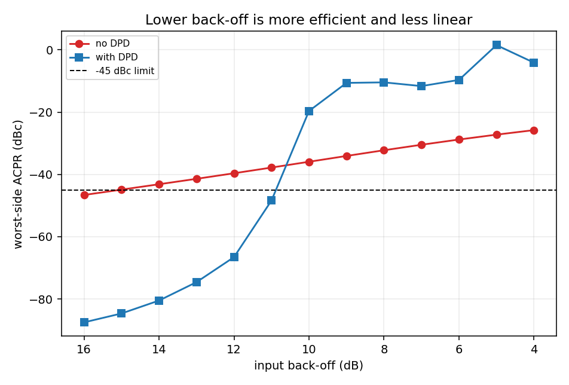
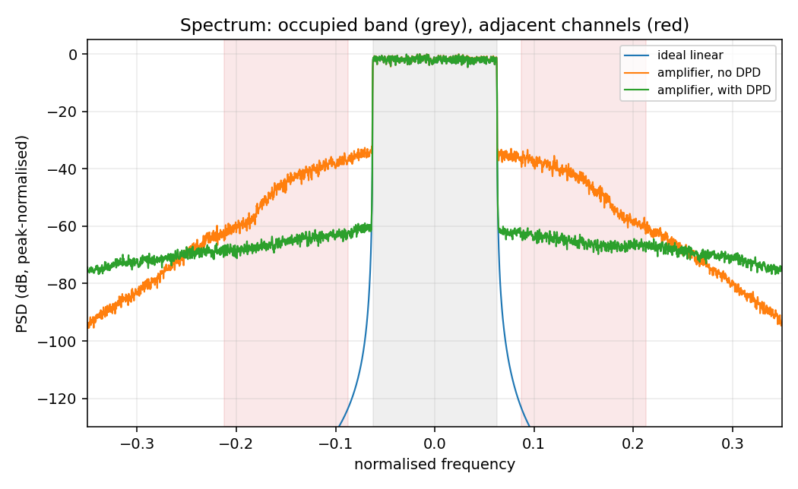
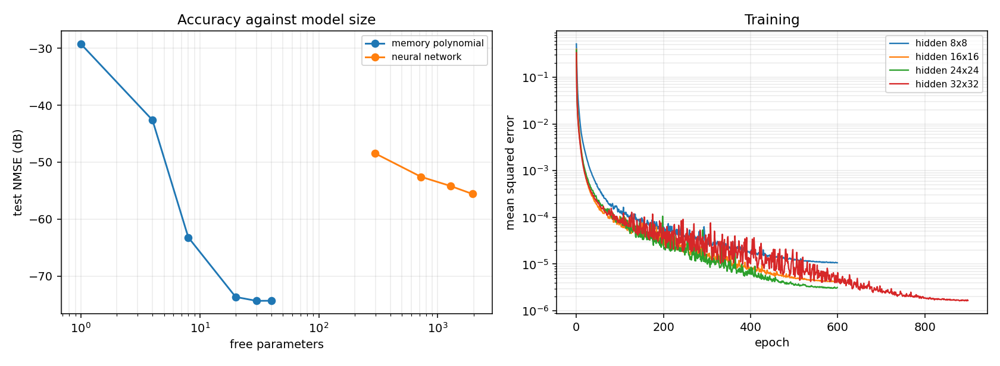
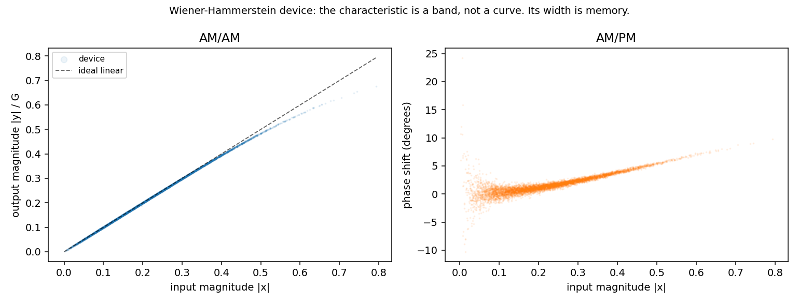

# RF power amplifier behavioural modelling and digital predistortion

Learn a behavioural model of a power amplifier from its input and output
records, then use that model to linearise it. Pure numpy, no external simulator,
no API keys.

This is the problem transmitter design turns on. Amplifier efficiency rises as
you approach saturation, and distortion rises with it, so the spectral mask —
not the amplifier — usually sets how hard you may drive. Predistortion buys back
linearity, which lets you run closer to saturation for the same emitted
adjacent-channel power. **The back-off recovered is the efficiency gain.**

```bash
pip install numpy matplotlib
python scripts/run_experiment.py     # ~2.5 minutes, writes figures/ and results.json
pytest -q                            # 39 tests
```

---

## Headline results

Measured on a Wiener–Hammerstein device at 12 dB input back-off, driven by a
32768-sample multicarrier signal with 10.1 dB PAPR. All figures are held-out
test NMSE on a signal the model never saw.

### Predistortion

| | ACPR (worst side) |
|---|---|
| amplifier, no predistortion | −39.6 dBc |
| amplifier, with predistortion | **−63.2 dBc** |
| linearisation NMSE | −36.6 dB |

**Back-off recovered at a −45 dBc limit: 4.2 dB.** That is the number that
matters — 4.2 dB less power wasted keeping the amplifier linear.



### Predistortion has a hard physical limit

| envelope peak | back-off | what happens |
|---|---|---|
| below saturation | ≥ 11 dB | ACPR improves by 5 to 41 dB |
| above saturation | ≤ 10 dB | ACPR gets **worse** |

The crossover sits exactly at peak envelope = saturation, and this is physics
rather than a tuning failure. Past saturation the amplifier maps many different
inputs to the same clipped output, so it is not invertible and no pre-inverse
exists. An implementation that appeared to improve ACPR in that regime would be
wrong, and the test suite asserts the failure.



### Model accuracy against model size

Measured at **12 dB input back-off**. See the next section for why that matters.

| model | parameters | test NMSE |
|---|---|---|
| MP, K=[1], M=1 | 1 | −29.2 dB |
| MP, K=[1,3], M=2 | 4 | −42.6 dB |
| MP, K=[1,3,5,7], M=2 | 8 | −63.2 dB |
| **MP, K=[1,3,5,7], M=5** | **20** | **−73.7 dB** |
| MP, K=[1..11], M=5 | 30 | −74.4 dB |
| MP, K=[1..15], M=5 | 40 | −74.3 dB |
| TDNN, hidden 8×8 | 298 | −48.5 dB |
| TDNN, hidden 16×16 | 722 | −52.6 dB |
| TDNN, hidden 32×32 | 1954 | −55.6 dB |

**The memory polynomial wins outright here, and it is not close.** Twenty
coefficients beat a 1954-parameter neural network by 18 dB. This is the correct
baseline result and it is why memory polynomials remain the industry default:
the model is linear in its coefficients, so identification is a single
least-squares solve with no local minima, no learning rate, and reproducibility
to the last bit.



### …but which model wins depends on the operating point

The table above is measured at 12 dB back-off, where envelope peaks stay below
saturation. Drive the amplifier harder and the ranking changes. Run
`python scripts/backoff_comparison.py` to reproduce:

| model | parameters | 12 dB back-off<br>(peak 0.80) | 6 dB back-off<br>(peak 1.60) |
|---|---|---|---|
| MP, K=[1,3,5,7], M=5 | 20 | **−73.7 dB** | −42.2 dB |
| MP, K=[1..11], M=5 | 30 | **−74.4 dB** | −59.3 dB |
| TDNN, hidden 16×16 | 722 | −52.6 dB | −53.0 dB |
| TDNN, hidden 32×32 | 1954 | −55.6 dB | −57.6 dB |

Below saturation the polynomial dominates by ~19 dB. Pushed into saturation its
advantage collapses: the 20-coefficient polynomial falls to −42.2 dB and is now
beaten by a 722-parameter network by 11 dB, while the networks barely move.

The same reversal shows in how polynomial accuracy responds to the sharpness of
the saturation knee (Rapp `p`, larger meaning a harder corner):

| Rapp p | 12 dB back-off | 6 dB back-off |
|---|---|---|
| 1 | −69.7 dB | −57.8 dB |
| 2 | −74.4 dB | −59.3 dB |
| 4 | −75.5 dB | −48.6 dB |
| 10 | −75.5 dB | **−41.0 dB** |

Below saturation a sharper knee is *easier* to model, because the amplifier
never reaches the corner and behaves almost linearly. Above saturation it is
much harder, and the polynomial loses 16 dB going from `p=2` to `p=10`. A
polynomial basis converges slowly on a near-discontinuity — the same reason
Fourier series struggle at a step — and that is precisely the regime where a
neural model earns its parameters.

**The honest summary: a memory polynomial is the right default, and reaching for
a network before checking it is a mistake. The network earns its keep only when
the amplifier is driven hard into a sharp saturation.**

---

## How it works

```
signals.py            multicarrier baseband generation, Welch PSD, band power
pa.py                 the device under test: Rapp or Saleh nonlinearity inside a
                      Wiener-Hammerstein cascade
memory_polynomial.py  MP and GMP basis construction, least-squares identification
neural.py             time-delay neural network, backprop derived by hand,
                      plus an optional PyTorch backend that cross-checks it
metrics.py            NMSE, ACPR, EVM, delay alignment, memory-spread estimator
dpd.py                indirect-learning predistorter, back-off sweep
```

**The ground truth is deliberately not a memory polynomial.** If it were, a
memory polynomial could fit it exactly and the comparison would be rigged — you
would be measuring least squares against itself. The device is a
Wiener–Hammerstein cascade instead: an LTI filter, a memoryless nonlinearity,
another LTI filter. Every model here is therefore a genuine approximation of a
different structure, which is the honest situation you are in with hardware.

**Memory is what makes this hard.** A memoryless amplifier has a single-valued
AM/AM characteristic: given the input magnitude, the output magnitude is
determined. Memory breaks that, because the output also depends on the
envelope's recent history, so the characteristic becomes a band. The width of
that band is the memory, and it is exactly what a memoryless model cannot
capture.



**Predistortion by indirect learning.** What you want is the amplifier's
pre-inverse, a block `f` with `PA(f(x)) = G·x`. Training that directly is awkward
because the amplifier sits between the parameters and the loss. The indirect
approach trains a *post*-inverse instead — a block mapping the amplifier's
output back to its input — which is an ordinary regression with no amplifier in
the loop, and then deploys it unchanged as the pre-inverse. With a memory
polynomial that is a single matrix solve per iteration.

---

## Two measurement bugs found while building this

Both are documented in the docstrings, because in each case the first
implementation produced plausible numbers that were wrong.

**ACPR bands flush against the occupied band measure window leakage.** Placing
the adjacent channel immediately beside the occupied one gave −28 dBc on a
perfectly clean, undistorted signal whose guard band is 140 dB down. The
measurement floor was 12 dB worse than most of the distortion being studied, so
every ACPR number was leakage rather than amplifier. Defining the adjacent
channel on a spacing 1.2× the occupied bandwidth — which is what real standards
do, and for this reason — moved the floor to **−135 dBc**.

**Grid-resolution peak finding.** A logarithmic sweep at 24 points per decade
has about 10% spacing, so the largest *sampled* point reported a 5 kHz resonance
as 5109 Hz, a 2.2% error large enough to fail a tight specification on a correct
circuit. The grid now only brackets the peak and a golden-section search in
log-frequency refines it. The refined answer of 4968 Hz is not 5000 Hz either,
and that part is real: a series RLC measured across its capacitor peaks at
`f₀·√(1 − 1/2Q²)`, which at Q ≈ 6 is 0.6% low.

---

## Development

```bash
pytest -q      # 39 tests, ~11 seconds
```

Expected values are derived from theory rather than captured from previous runs,
so a change in behaviour fails instead of quietly re-baselining. The
load-bearing tests:

- `test_recovers_a_known_memory_polynomial` — generates data from an MP with
  known coefficients and checks least squares recovers them to machine
  precision. Only passes if the basis ordering, delay convention and solve all
  agree.
- `test_gradients_match_finite_differences` — the neural network's backward pass
  is hand-written, so it is checked numerically rather than trusted. Worst
  relative error 4×10⁻⁸.
- `test_numpy_and_torch_backends_agree` — cross-validates the hand-derived
  gradients against autograd on identical architecture, features and seed.
- `test_dpd_fails_when_peaks_exceed_saturation` — asserts a physical limit, not
  a software behaviour.

---

## Limitations

- **Simulated device, not measured hardware.** The amplifier is a
  Wiener–Hammerstein model. Real devices add thermal and bias memory with much
  longer time constants than the three FIR taps used here.
- **No crest-factor reduction.** CFR and DPD are deployed together in practice;
  the back-off numbers here would improve with it.
- **Single-band, no I/Q imbalance, no LO leakage.** The signal is a clean
  complex baseband envelope.
- **Static model.** Real predistorters adapt continuously as the amplifier warms
  and the channel changes.
- **The neural model is a plain TDNN.** Recurrent and residual architectures are
  where neural behavioural models usually earn their parameters.

---

## Licence

MIT. See [LICENSE](LICENSE).
